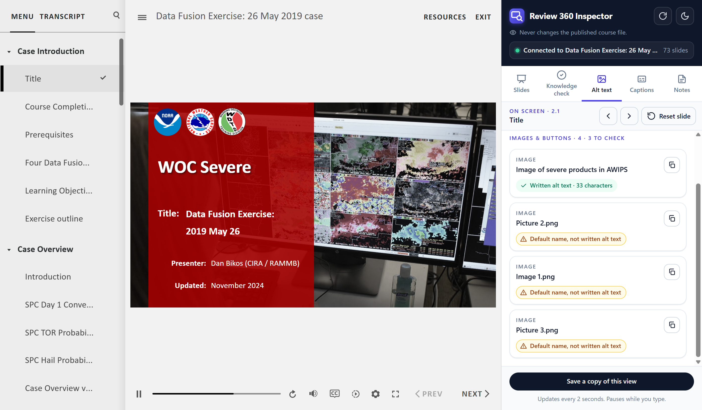

# Review 360 Inspector

A Chrome extension for reviewing published Articulate Storyline courses and Review 360 links. It opens beside the course and shows, for the slide on screen, the alt text on every image and button, the closed captions, and the slide notes, each with a copy button. It can also jump to any slide and show the correct answers on knowledge checks.

Storyline's published player gives a reviewer none of this directly. Captions and notes can't be copied out of the player, and alt text is only heard through a screen reader. Checking a course meant clicking through every slide and retyping what was there.

*The Alt text tab beside a public Storyline course (National Weather Service, Data Fusion Exercise). One image on this slide has written alt text; the other three still carry Storyline's default file names.*

**New to it?** The visual step-by-step guide is [How to use Review 360 Inspector.pdf](How%20to%20use%20Review%20360%20Inspector.pdf). It covers installing, opening a course, and every tab.

## How it works

- Manifest V3 extension with a Chrome side panel and a DevTools tab.
- It reads the Storyline 360 player already running in the page: the slide models, the hidden screen-reader copy of each slide, the captions manager, and the notes data. The scripts run in every frame, so it also works when the course sits inside an LMS iframe or on Review 360.
- It flags alt text that is really Storyline's placeholder, such as a file name ("Picture 2.png") or a numbered name ("Rectangle 7"), images marked decorative, and buttons hidden from screen readers. Player controls, closed layers, and invisible or zero-sized objects are left out.
- Read-only by design. It makes no network calls and sends nothing out of the browser. Reset slide is the only control that changes the running course, and the published course file is never edited.
- Light and dark themes in slate with an indigo accent, using the system font.
- Tests run in the browser. There is no build step and no Node dependency.

## Install from GitHub

1. On this page, click **Code**, then **Download ZIP**, and unzip it. You get a folder named `review-360-inspector-main`. Keep it somewhere it can stay, such as Documents.
2. Open `chrome://extensions` (or `edge://extensions`) and turn on **Developer mode**.
3. Click **Load unpacked** and select the folder that contains `manifest.json`.
4. Open the published course and click the extension's toolbar icon to open the side panel. Or press F12 and open the **Review 360 Inspector** tab, which is handy when the side panel covers the course.

For a course opened from a folder on the PC (`file://`), open the extension's details and turn on **Allow access to file URLs**, then reload the course.

The PDF guide describes installing from a zip file shared directly. After unzipping, the steps are the same.

## What each tab does

Open a published course, or a Review 360 link the publisher sent, then use the side panel or the DevTools tab. On Review 360, start the course and wait for the first slide.

The panel has five tabs, and a slide bar under them that always shows the slide on screen with Previous, Next, and Reset slide.

**Slides**
- Jump straight to any slide by clicking it in the list, grouped by scene. Question slides are tagged "Knowledge check".
- Play through the course for a recording. Each slide plays for its published length, then Next is pressed. Playback holds on a knowledge check and continues once you leave it.
- The course menu lock is shown read-only. This tool does not change it.

**Knowledge check**
- "This question" shows whether the question on screen is answered, and resets that slide to the way it opened so another answer can be chosen.
- See the correct choice, accepted answers, and passing score. "Outline the correct choice" draws a box on the slide without answering.
- A list of every knowledge check in the course, with Open links, and a "Slide details" section (states, layers, triggers, notes) with a "Copy slide details for support" button that copies names only.

**Alt text**
- Images and buttons on the slide, top to bottom, each with the alt text a screen reader reads. Turn off "Images and buttons only" to see text, shapes, and answer choices as well.
- Each one is marked:
  - **Written alt text** – someone typed it.
  - **Default name, not written alt text** – Storyline's placeholder was left in.
  - **No alt text** – a screen reader gets nothing.
  - **Decorative · hidden from screen readers** – "Object is visible to accessibility tools" is off for that image.
  - **Hidden from screen readers** on a button or answer choice – flagged, because learners have to use it.
- Images without alt text show their file name so they can be found.
- Click an object to draw a box over it on the slide. The box stays until you click that object again. The copy button copies the alt text.

**Captions**
- Every closed caption for the slide on screen, in order, with its start time, so the narration can be checked without playing the slide. Captions on other layers are listed under that layer's name.
- "Copy captions" copies the text, one caption per line. Caption files imported as SRT, VTT, or SBV all publish the same way and show here.

**Notes**
- The text of the player's Notes tab (some courses rename it Transcript), one line per paragraph. "Copy notes" copies it as plain text.

Captions and Notes follow the course when the slide changes. "Save a copy of this view" includes the notes, and the captions with their times.

## Privacy

Variable values, slide titles, quiz answers, and object ids stay in this browser. The extension has no server and no analytics.

Chrome shows a broad site-access warning when it is installed. That permission is what lets the panel reach a course inside an LMS iframe. The scripts only read the Storyline player (`GetPlayer`, `getVar`, `DS`) and elements with `data-model-id`. They do not read cookies, and the address shown in the panel omits the query string.

To confirm there is no network call, search the extension's scripts for `fetch(`, `XMLHttpRequest`, and `WebSocket`. The only matches are in `test/`.

## If a course does not respond

- Wait until the first slide is visible, then click Refresh.
- In DevTools, check that you are on the course tab, not a blank frame.
- Review 360 and a SCORM publish do not expose the same jump method. If jump is unavailable, use Play through or the course Next button.
- Passing-score and correct-answer data have to be present in the published player. Open the question slide first if the Knowledge check tab says the slide has no knowledge check.

## Project layout

- `manifest.json`, `background.js`: extension setup and the side panel.
- `panel.html`, `panel.css`, `panel.js`: the panel. `panel.css` has the colour tokens at the top and the look (header, tabs, buttons, cards) at the end.
- `inspector-core.js`, `page-bridge.js`: injected into the course page; they read the Storyline player.
- `devtools.html`, `devtools.js`: the DevTools tab.
- `icons/`: the toolbar icons and the panel's app mark (`mark.svg`).
- `test/`: browser tests. `demo/mock-course.html`: a stand-in player for a first check, not a real Storyline publish.
- `docs/`: the screenshot above.

If you edit `inspector-core.js` or `page-bridge.js`, keep them free of Unicode noncharacters (such as U+FFFF). Chrome refuses to inject a file containing one and reports "It isn't UTF-8 encoded". `test/syntax.html` checks for this.

This version grew out of an earlier extension, Local Storyline Inspector 2.1.8. The two can be loaded side by side.

## Tests

Open `test/run.html` in a browser; the page title reads PASS or FAIL. `test/syntax.html` loads the real panel against a stub `chrome` object and reports SYNTAX-OK. `test/bridge.html` checks how objects on a slide are found and classified.

Storyline's player changes between versions. If a real course connects but a list is empty, note which publish was used (web, SCORM, or Review 360) and what the panel shows.

This is a separate tool. It is not the Storyline Course Inspector from ReviewMyElearning.com, and it is not for resale.
